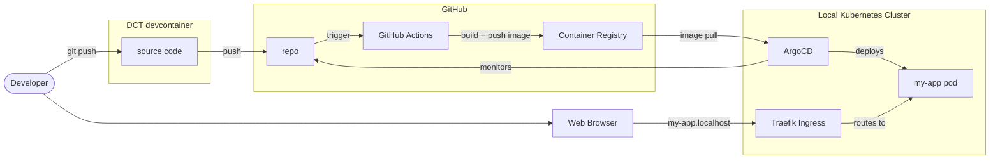
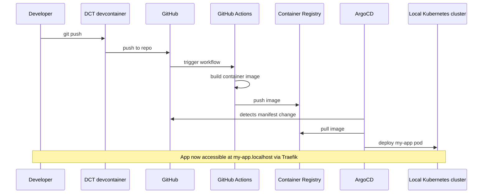

import TemplateHeader from '@site/src/components/TemplateHeader';

<TemplateHeader
  logo="/img/templates/node-two-service-webapp-logo.svg"
  name="Node Two-Service Web App"
  version="1.0.0"
  description="Public web service plus internal API service, ready for UIS and the Red Cross container platform"
  abstract={"A starting point for an application with a public web front end and an internal API, each its own container under services/. The same Dockerfiles deploy on UIS (ArgoCD, GitHub Actions, ghcr.io) and on the Red Cross container platform (Azure Container Apps), because the layout follows the platform's: one folder per service, Docker build context is the service folder."}
  install="dev-template node-two-service-webapp"
  links={[{"url":"https://github.com/helpers-no/dev-templates/tree/main/templates/node-two-service-webapp","title":"Source code","icon":"github"}]}
  maintainers={["terchris"]}
  tags={["nodejs","express","webapp","two-service","uis","azure-container-apps","redcross"]}
  tools="dev-typescript"
/>


<div className="templateCard">
<div className="templateCardEyebrow">GETTING STARTED</div>

### Prerequisites

- [ ] [DCT devcontainer running](https://dct.sovereignsky.no)

### Files

<details className="dropdownBlock">
<summary>Files (16)</summary>

<pre className="filesTree">
├── <a href="https://github.com/helpers-no/dev-templates/blob/main/templates/node-two-service-webapp/.gitignore" target="_blank" rel="noopener noreferrer">.gitignore</a>
├── <a href="https://github.com/helpers-no/dev-templates/blob/main/templates/node-two-service-webapp/README-node-two-service-webapp.md" target="_blank" rel="noopener noreferrer">README-node-two-service-webapp.md</a>
├── <a href="https://github.com/helpers-no/dev-templates/blob/main/templates/node-two-service-webapp/template-info.yaml" target="_blank" rel="noopener noreferrer">template-info.yaml</a>
├── .github/
│   └── workflows/
│       └── <a href="https://github.com/helpers-no/dev-templates/blob/main/templates/node-two-service-webapp/.github/workflows/urbalurba-build-and-push.yaml" target="_blank" rel="noopener noreferrer">urbalurba-build-and-push.yaml</a>
├── manifests/
│   ├── <a href="https://github.com/helpers-no/dev-templates/blob/main/templates/node-two-service-webapp/manifests/deployment.yaml" target="_blank" rel="noopener noreferrer">deployment.yaml</a>
│   └── <a href="https://github.com/helpers-no/dev-templates/blob/main/templates/node-two-service-webapp/manifests/kustomization.yaml" target="_blank" rel="noopener noreferrer">kustomization.yaml</a>
└── services/
    ├── api/
    │   ├── <a href="https://github.com/helpers-no/dev-templates/blob/main/templates/node-two-service-webapp/services/api/.dockerignore" target="_blank" rel="noopener noreferrer">.dockerignore</a>
    │   ├── <a href="https://github.com/helpers-no/dev-templates/blob/main/templates/node-two-service-webapp/services/api/Dockerfile" target="_blank" rel="noopener noreferrer">Dockerfile</a>
    │   └── app/
    │       ├── <a href="https://github.com/helpers-no/dev-templates/blob/main/templates/node-two-service-webapp/services/api/app/package-lock.json" target="_blank" rel="noopener noreferrer">package-lock.json</a>
    │       ├── <a href="https://github.com/helpers-no/dev-templates/blob/main/templates/node-two-service-webapp/services/api/app/package.json" target="_blank" rel="noopener noreferrer">package.json</a>
    │       └── <a href="https://github.com/helpers-no/dev-templates/blob/main/templates/node-two-service-webapp/services/api/app/server.js" target="_blank" rel="noopener noreferrer">server.js</a>
    └── web/
        ├── <a href="https://github.com/helpers-no/dev-templates/blob/main/templates/node-two-service-webapp/services/web/.dockerignore" target="_blank" rel="noopener noreferrer">.dockerignore</a>
        ├── <a href="https://github.com/helpers-no/dev-templates/blob/main/templates/node-two-service-webapp/services/web/Dockerfile" target="_blank" rel="noopener noreferrer">Dockerfile</a>
        └── app/
            ├── <a href="https://github.com/helpers-no/dev-templates/blob/main/templates/node-two-service-webapp/services/web/app/package-lock.json" target="_blank" rel="noopener noreferrer">package-lock.json</a>
            ├── <a href="https://github.com/helpers-no/dev-templates/blob/main/templates/node-two-service-webapp/services/web/app/package.json" target="_blank" rel="noopener noreferrer">package.json</a>
            └── <a href="https://github.com/helpers-no/dev-templates/blob/main/templates/node-two-service-webapp/services/web/app/server.js" target="_blank" rel="noopener noreferrer">server.js</a>
</pre>

</details>
### Related templates

- [TypeScript Basic Webserver](../basic-web-server/typescript-basic-webserver)
- [Python Basic Webserver](../basic-web-server/python-basic-webserver)

</div>

import TemplateEnvironment from '@site/src/components/TemplateEnvironment';

<TemplateEnvironment
  requires={null}
  params={{"app_name":"my-app"}}
  quickstart={{"title":"Run both services","setup":["npm ci --prefix services/api/app","npm ci --prefix services/web/app"],"run":"(PORT=3001 npm start --prefix services/api/app &) ; API_URL=http://localhost:3001 npm start --prefix services/web/app","note":"The API runs on port 3001 and the web service on port 3000 (VS Code forwards it).\nIn a container both services listen on 3000; the web service finds the API through API_URL.\n"}}
  tools={[{"id":"dev-typescript","name":"TypeScript Development Tools","description":"Adds TypeScript and development tools (Node.js already in devcontainer)","website":"https://www.typescriptlang.org","docsUrl":"https://dct.sovereignsky.no/docs/tools/development-tools/typescript"}]}
  services={[]}
  templateKind={"app"}
  initFiles={{}}
  configureCommand={null}
  templateInfoYaml={null}
  expectedOutputBlock={null}
/>


<div className="templateCard">
<div className="templateCardEyebrow">ARCHITECTURE</div>

## Architecture

These diagrams are auto-generated from the template's metadata. Click any diagram to enlarge.

### Deployment

<details className="dropdownBlock">
<summary>Components</summary>



<a href="https://mermaid.live/edit#base64:eyJjb2RlIjoiZmxvd2NoYXJ0IExSXG4gICAgZGV2KFtcIkRldmVsb3BlclwiXSlcbiAgICBicm93c2VyW1wiV2ViIEJyb3dzZXJcIl1cblxuICAgIHN1YmdyYXBoIGRjdFtcIkRDVCBkZXZjb250YWluZXJcIl1cbiAgICAgICAgc3JjW1wic291cmNlIGNvZGVcIl1cbiAgICBlbmRcblxuICAgIHN1YmdyYXBoIGdoW1wiR2l0SHViXCJdXG4gICAgICAgIHJlcG9bXCJyZXBvXCJdXG4gICAgICAgIGFjdGlvbnNbXCJHaXRIdWIgQWN0aW9uc1wiXVxuICAgICAgICBnaGNyW1wiQ29udGFpbmVyIFJlZ2lzdHJ5XCJdXG4gICAgZW5kXG5cbiAgICBzdWJncmFwaCBrOHNbXCJMb2NhbCBLdWJlcm5ldGVzIENsdXN0ZXJcIl1cbiAgICAgICAgdHJhZWZpa1tcIlRyYWVmaWsgSW5ncmVzc1wiXVxuICAgICAgICBhcmdvW1wiQXJnb0NEXCJdXG4gICAgICAgIHBvZFtcIm15LWFwcCBwb2RcIl1cbiAgICBlbmRcblxuICAgIGRldiAtLT58Z2l0IHB1c2h8IHNyY1xuICAgIHNyYyAtLT58cHVzaHwgcmVwb1xuICAgIHJlcG8gLS0+fHRyaWdnZXJ8IGFjdGlvbnNcbiAgICBhY3Rpb25zIC0tPnxidWlsZCArIHB1c2ggaW1hZ2V8IGdoY3JcbiAgICBhcmdvIC0tPnxtb25pdG9yc3wgcmVwb1xuICAgIGdoY3IgLS0+fGltYWdlIHB1bGx8IGFyZ29cbiAgICBhcmdvIC0tPnxkZXBsb3lzfCBwb2RcbiAgICB0cmFlZmlrIC0tPnxyb3V0ZXMgdG98IHBvZFxuICAgIGJyb3dzZXIgLS0+fG15LWFwcC5sb2NhbGhvc3R8IHRyYWVmaWtcbiAgICBkZXYgLS0+IGJyb3dzZXIiLCJtZXJtYWlkIjoie1widGhlbWVcIjpcImRlZmF1bHRcIn0ifQ==" target="_blank" rel="noopener noreferrer" className="mermaidLiveLink">↗ Open in mermaid.live</a>

</details>

<details className="dropdownBlock">
<summary>Flow</summary>



<a href="https://mermaid.live/edit#base64:eyJjb2RlIjoic2VxdWVuY2VEaWFncmFtXG4gICAgcGFydGljaXBhbnQgRGV2IGFzIERldmVsb3BlclxuICAgIHBhcnRpY2lwYW50IERDVCBhcyBEQ1QgZGV2Y29udGFpbmVyXG4gICAgcGFydGljaXBhbnQgR0ggYXMgR2l0SHViXG4gICAgcGFydGljaXBhbnQgQWN0aW9ucyBhcyBHaXRIdWIgQWN0aW9uc1xuICAgIHBhcnRpY2lwYW50IEdIQ1IgYXMgQ29udGFpbmVyIFJlZ2lzdHJ5XG4gICAgcGFydGljaXBhbnQgQXJnbyBhcyBBcmdvQ0RcbiAgICBwYXJ0aWNpcGFudCBLOHMgYXMgTG9jYWwgS3ViZXJuZXRlcyBjbHVzdGVyXG4gICAgRGV2LT4+RENUOiBnaXQgcHVzaFxuICAgIERDVC0+PkdIOiBwdXNoIHRvIHJlcG9cbiAgICBHSC0+PkFjdGlvbnM6IHRyaWdnZXIgd29ya2Zsb3dcbiAgICBBY3Rpb25zLT4+QWN0aW9uczogYnVpbGQgY29udGFpbmVyIGltYWdlXG4gICAgQWN0aW9ucy0+PkdIQ1I6IHB1c2ggaW1hZ2VcbiAgICBBcmdvLT4+R0g6IGRldGVjdHMgbWFuaWZlc3QgY2hhbmdlXG4gICAgQXJnby0+PkdIQ1I6IHB1bGwgaW1hZ2VcbiAgICBBcmdvLT4+SzhzOiBkZXBsb3kgbXktYXBwIHBvZFxuICAgIE5vdGUgb3ZlciBEZXYsSzhzOiBBcHAgbm93IGFjY2Vzc2libGUgYXQgbXktYXBwLmxvY2FsaG9zdCB2aWEgVHJhZWZpayIsIm1lcm1haWQiOiJ7XCJ0aGVtZVwiOlwiZGVmYXVsdFwifSJ9" target="_blank" rel="noopener noreferrer" className="mermaidLiveLink">↗ Open in mermaid.live</a>

</details>

</div>

## Template README


A public **web** service and an internal **api** service, one container each. It is a hello world: the web page shows the answer it got from the API, to prove that the two containers can talk to each other on both platforms.

The layout deliberately follows the **Red Cross container platform** (`services/<name>/` with its own `Dockerfile` and `app/`), so the same folders deploy on **UIS** and on **Azure Container Apps**.

## Quick Start

### Run locally

1. `npm ci --prefix services/api/app && npm ci --prefix services/web/app`
2. `(PORT=3001 npm start --prefix services/api/app &) ; API_URL=http://localhost:3001 npm start --prefix services/web/app`
3. Open http://localhost:3000: "Hello World" and the answer from the API.

### Deploy on UIS

1. Run `dev-template node-two-service-webapp` in your repository, commit and push to `main` on GitHub. The workflow `.github/workflows/urbalurba-build-and-push.yaml` builds `services/web` and `services/api`, pushes `ghcr.io/<you>/<repo>-web` and `-api`, and writes the tags into `manifests/deployment.yaml`.
2. Register the repository: `./uis argocd register <repo> https://github.com/<you>/<repo>`.
3. Open http://`<repo>`.localhost. (Private repository or private images: see the UIS docs on `uis secrets` and image pull secrets.)

### Deploy on the Red Cross container platform

The platform creates the pipelines and the infrastructure for each service itself; this template provides what goes inside:

1. In your platform repository run the **add-service** pipeline twice: once for the public web service, once for the API (**public endpoint: false**). Service names must be unique across the platform (they become DNS names). Merge the pull requests it raises. You now have `services/<web-name>/` and `services/<api-name>/` with generated Bicep and pipelines.
2. Copy this template's `services/web/Dockerfile` and `services/web/app/` over `services/<web-name>/`, and `services/api/...` over `services/<api-name>/`. Both listen on port 3000 and answer `/health`, the platform's defaults, so `ingressTargetPort` and `healthCheckPath` need no change.
3. Tell the web service where the API is, in `services/<web-name>/infra/aca/aca.test.bicepparam` (and `aca.prod.bicepparam`):

   ```bicep
   param appEnvironmentVariables = [
     { name: 'ENVIRONMENT', value: 'Test' }
     // the API Container App's name is its internal host name: ca-<env>-nrx-<api-name>
     { name: 'API_URL', value: 'http://ca-test-nrx-<api-name>' }
   ]
   ```
4. Run the service's build pipeline, then its deploy pipeline (`test`, then `prod`).

Do not copy this template's `manifests/` or `.github/` into a Red Cross repository; they are for UIS.

## Prerequisites

- **UIS:** the DCT devcontainer, the UIS provision-host running with a local cluster, and ArgoCD deployed (`./uis deploy argocd`).
- **Red Cross platform:** a repository created by the Platform Team (the "request a new application" step) with the add-service pipeline.
- Node.js 24 (installed by the devcontainer tools).

## Project Structure

```plaintext
your-project/
├── services/
│   ├── web/                       # public front end
│   │   ├── Dockerfile             # build context = this folder
│   │   └── app/{server.js, package.json, package-lock.json}
│   └── api/                       # internal API
│       ├── Dockerfile
│       └── app/{server.js, package.json, package-lock.json}
├── manifests/                     # UIS only: Deployments + Services, kustomization
│   ├── deployment.yaml
│   └── kustomization.yaml
├── .github/workflows/urbalurba-build-and-push.yaml   # UIS only: build, push, update tags
└── README-node-two-service-webapp.md
```

## Things to know

- **Keep `GET /health`** in both services. It must answer 200 without calling anything else: a brief outage of the API must not make the platform restart a healthy web container.
- **The browser can only reach the web service.** The API is internal on both platforms, so call it from the web server (as `server.js` does), never from browser JavaScript.
- **UIS routes the host name to the first Service of the namespace in alphabetical order.** The public Service is named `{{REPO_NAME}}`, which sorts before `{{REPO_NAME}}-api`. Do not rename them without checking that.
- **Service names on the Red Cross platform must be unique across the whole platform**, so rename the folders `web` and `api` to your chosen service names when you add the services there.
- Secrets never go in the manifests or in `.bicepparam` files: use Kubernetes secrets on UIS and Key Vault references on the Red Cross platform.

